# Workshop : OWASP ZAP - Détection automatique des vulnérabilités Web

## 1. Objectif

Découvrir OWASP ZAP pour identifier les problèmes de sécurité d'une
application Web, analyser les rapports générés et présenter les bonnes
pratiques d'intégration du DAST dans une pipeline CI/CD.

## 2. Environnement

-   Application testée : UniLink (Next.js)
-   Lien Github  : https://github.com/soukina-nhaila/unilink
-   URL locale : `http://localhost:3000`
-   Outil : OWASP ZAP via Docker
-   Environnement : Ubuntu sous WSL
-   Répertoire de travail : `unilink_work`


### Étape 1 : Vérifier Docker

```bash
docker --version
docker ps
```
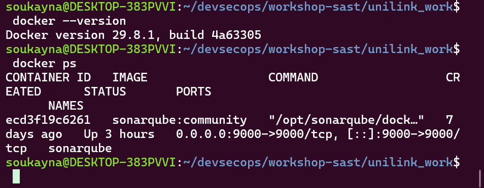

### Étape 2 : Vérifier que UniLink fonctionne

- Lancer l'application 
- Garder l’application lancée dans un terminal, puis ouvrir un deuxième terminal :

```bash
npm run dev
curl -s -D - -o /dev/null http://localhost:3000/auth/login
```

Résultat : `HTTP/1.1 200 OK`.

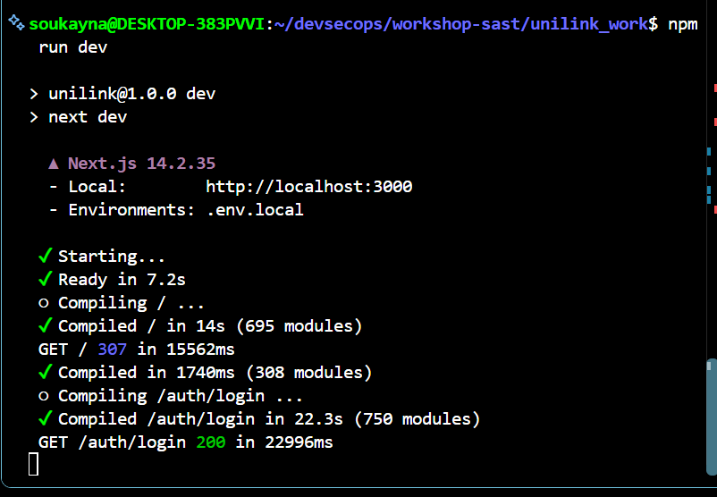
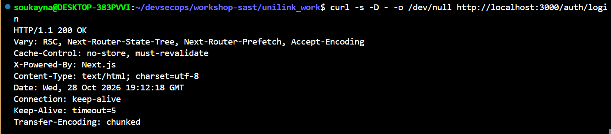

### Étape 3 : Télécharger l’image Docker

```bash
docker pull ghcr.io/zaproxy/zaproxy:stable
```
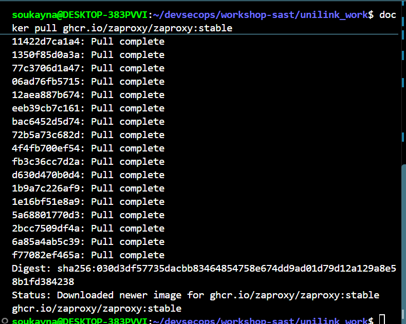
### Étape 4 : Vérifier que le conteneur ZAP peut accéder à UniLink

```bash
docker run --rm ghcr.io/zaproxy/zaproxy:stable \
  curl -sS -o /dev/null \
  -w "HTTP Status: %{http_code}\n" \
  http://host.docker.internal:3000
```

`host.docker.internal` permet au conteneur d’accéder à l’application lancée sur la machine hôte. La racine de l’application peut rediriger vers la page de connexion ; il faut donc interpréter le code HTTP obtenu en tenant compte de cette redirection.
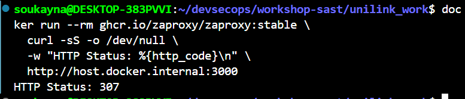


### Étape 5 : Créer le dossier des rapports

```bash
cd ~/devsecops/workshop-sast/unilink_work
mkdir -p zap-report
chmod 777 zap-report
```
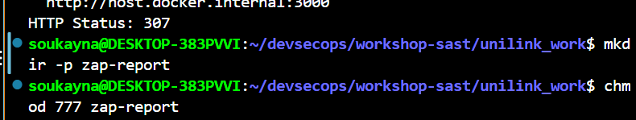


Les étapes suivantes sont le Baseline Scan, puis le scan actif limité, avec les commandes et les rapports HTML décrits dans les sections suivantes.

On vérifie si l'application est bien démarrée :

``` bash
curl -I --max-time 5 http://localhost:3000
```

Une réponse HTTP ou une redirection attendue confirme que l'application
répond.


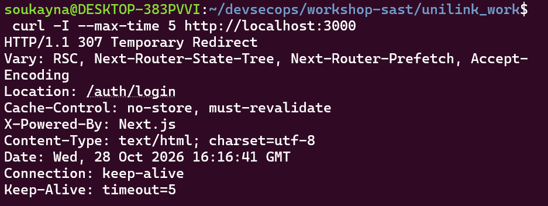

## 3. Baseline Scan : analyse passive

Le Baseline Scan explore l'application et examine passivement les
réponses HTTP, sans lancer les tests d'attaque de l'Active Scan.

### Commande exécutée

Depuis la racine du projet :

``` bash
docker run --rm \
  -v "$(pwd)/zap-report:/zap/wrk/:rw" \
  ghcr.io/zaproxy/zaproxy:stable \
  zap-baseline.py \
  -t http://host.docker.internal:3000 \
  -m 1 \
  -I \
  -r zap-baseline-recovery.html
```
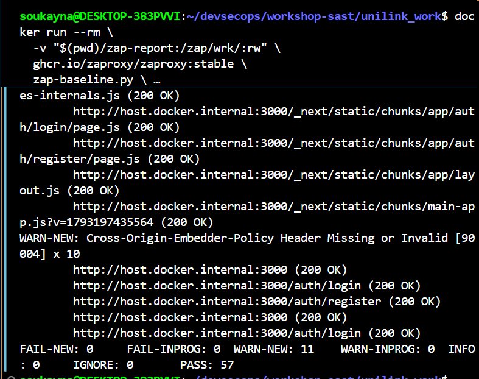
Rapport généré : `zap-report/zap-baseline-recovery.html`

### Résultat observé

-   `FAIL-NEW`: 0
-   `FAIL-INPROG`: 0
-   `WARN-NEW`: 11
-   `PASS`: 57
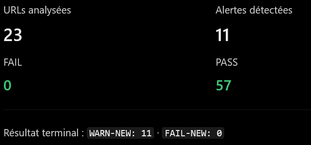
Les alertes comprenaient notamment des en-têtes HTTP manquants (CSP,
anti-clickjacking, `X-Content-Type-Options`, Permissions Policy), la
présence de `X-Powered-By`, des commentaires suspects dans des fichiers
JavaScript et des informations relatives à l'application Web. Une alerte
ZAP doit être examinée dans son contexte : elle n'est pas
automatiquement une vulnérabilité exploitable.

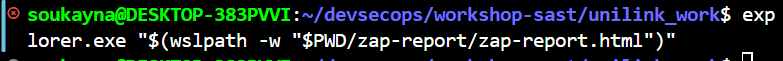
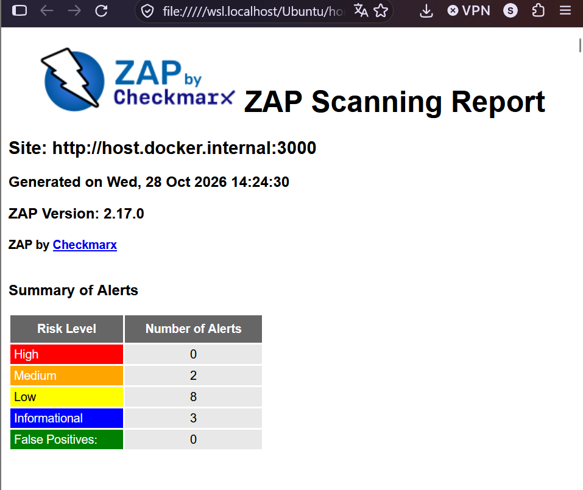
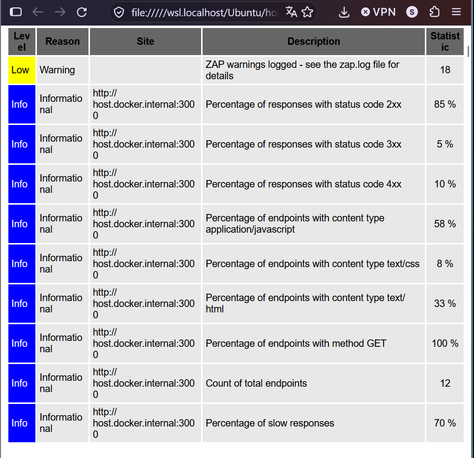
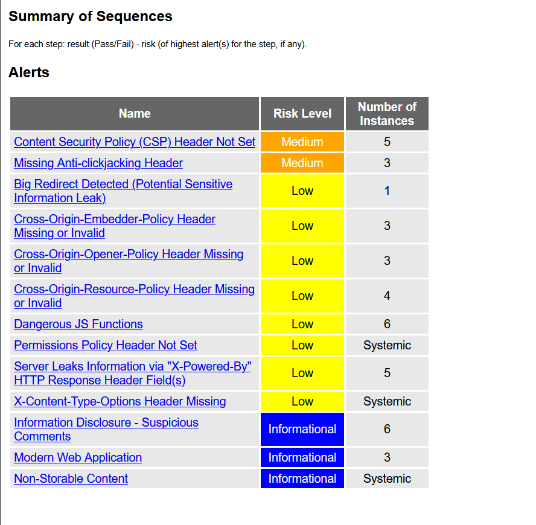
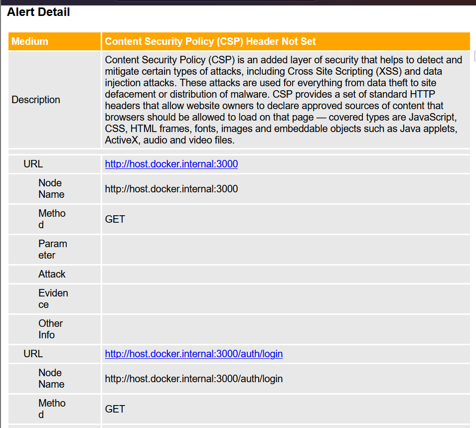
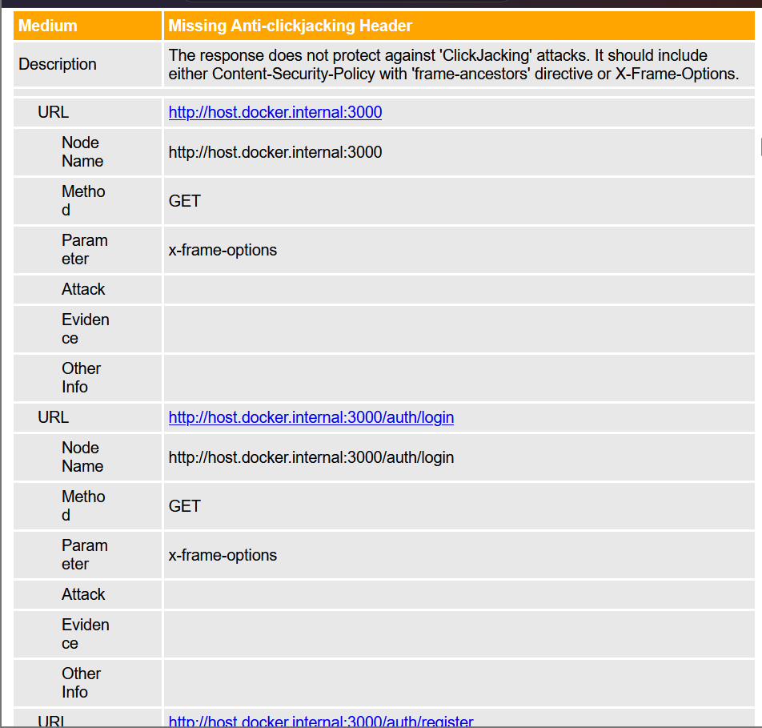

### Analyse des cookies et des en-têtes HTTP

Conformément aux objectifs du workshop, le rapport OWASP ZAP a été examiné afin d'identifier les cookies présentant des attributs de sécurité manquants et les en-têtes HTTP absents.

#### *1. Vérification des cookies `HttpOnly` et `Secure`*

La réponse HTTP de la page de connexion a été vérifiée avec la même commande .


La réponse obtenue était `HTTP/1.1 200 OK`, mais elle ne contenait pas d'en-tête `Set-Cookie`.

Il n'a donc pas été possible de confirmer, à partir de cette réponse, la présence de cookies de session propres à UniLink ni de vérifier leurs attributs `HttpOnly` et `Secure`.

- **HttpOnly :** empêche l'accès au cookie depuis JavaScript côté navigateur.
- **Secure :** limite l'envoi du cookie aux connexions HTTPS.

Pour conclure sur la sécurité des cookies d'UniLink, il faudrait examiner les cookies réellement créés par l'application, notamment après authentification.

#### *2. En-têtes HTTP manquants ou insuffisamment configurés*

Les rapports ZAP ont signalé plusieurs alertes relatives aux en-têtes HTTP :

| En-tête ou alerte | Risque associé |
|---|---|
| `Content-Security-Policy` (CSP) absent | Réduit les possibilités de limiter certaines attaques par injection de contenu, notamment XSS. |
| En-tête anti-clickjacking absent | Peut permettre l'intégration de pages dans un cadre malveillant. |
| `X-Content-Type-Options` absent | Peut laisser le navigateur interpréter certains contenus avec un type différent de celui déclaré. |
| `X-Powered-By` exposé | Révèle des informations sur la technologie utilisée par le serveur. |
| `Permissions-Policy` absent | Indique qu'aucune politique explicite n'a été détectée pour certaines fonctionnalités du navigateur. |
| COEP absent ou invalide | Peut indiquer une configuration incomplète des règles d'isolation des ressources. |

#### *3. Conclusion de l'observation*

Le scan a principalement mis en évidence des améliorations possibles concernant les en-têtes HTTP.

L'absence de `Set-Cookie` dans la réponse testée ne prouve pas que tous les cookies d'UniLink sont sécurisés.
## 4. Active Scan : analyse active limitée

Un Active Scan a été réalisé à titre de test sur l'application locale.
Il envoie des requêtes de test susceptibles de révéler des failles. Dans
un environnement réel, il doit être autorisé et de préférence effectué
sur une instance de test ou de préproduction.

Un premier lancement complet a rencontré des limites de mémoire. Une
configuration limitée a donc été créée dans
`zap-report/zap-active-limited.yaml`. Elle prévoit un Spider de 2
minutes, une attente du scan passif, puis un Active Scan de 3 minutes
avec un thread par hôte et une durée maximale d'une minute par règle.

### Fichier Yaml 
```
env:
  contexts:
    - name: "UniLink"
      urls:
        - "http://host.docker.internal:3000"
      includePaths:
        - "http://host.docker.internal:3000/.*"

jobs:
  - type: spider
    parameters:
      context: "UniLink"
      url: "http://host.docker.internal:3000"
      maxDuration: 2

  - type: passiveScan-wait
    parameters:
      maxDuration: 2

  - type: activeScan
    parameters:
      context: "UniLink"
      url: "http://host.docker.internal:3000"
      maxScanDurationInMins: 3
      maxRuleDurationInMins: 1
      threadPerHost: 1
      delayInMs: 100

  - type: report
    parameters:
      template: "traditional-html"
      reportDir: "/zap/wrk"
      reportFile: "zap-active-limited.html"
      reportTitle: "UniLink - Active Security Scan"
      reportDescription: "Limited active scan for the local development application"

```
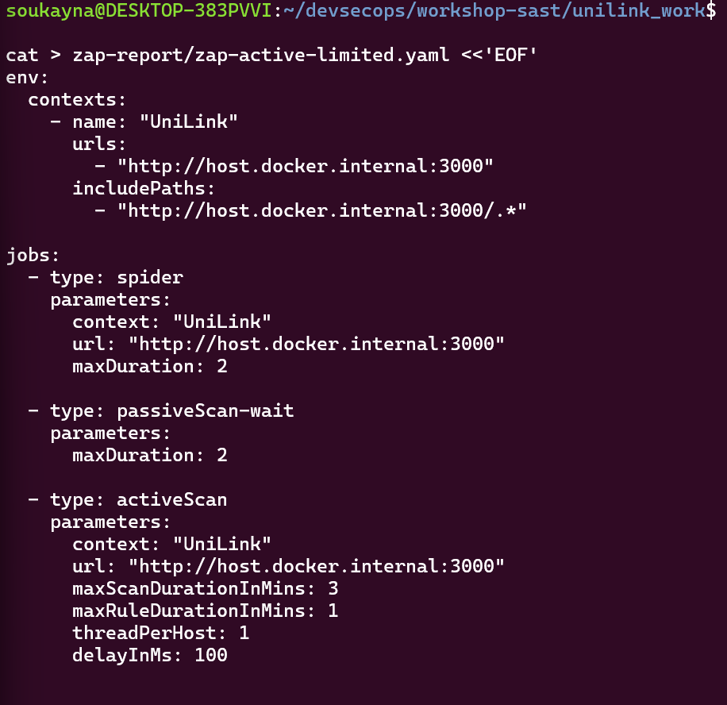
### Commande exécutée

``` bash
docker run --rm \
  -v "$(pwd)/zap-report:/zap/wrk/:rw" \
  ghcr.io/zaproxy/zaproxy:stable \
  zap.sh -cmd -autorun /zap/wrk/zap-active-limited.yaml
```
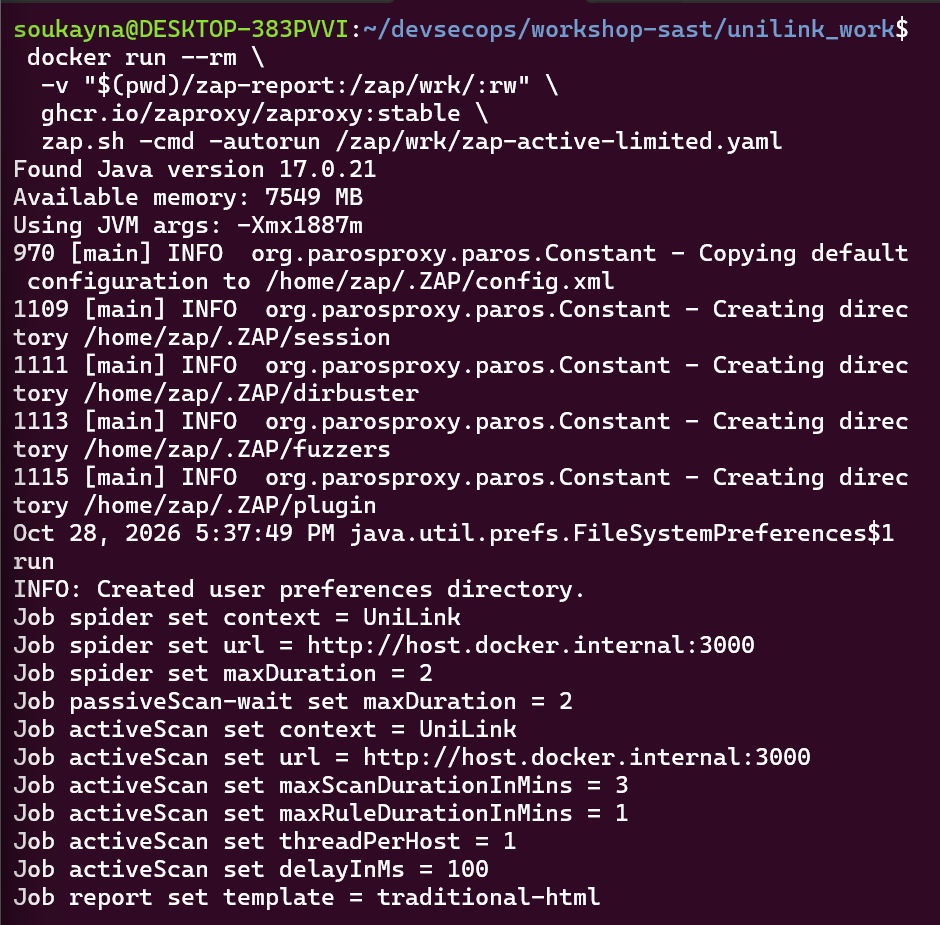
Le terminal a confirmé la fin du plan :

``` text
Job activeScan finished, time taken: 00:03:00
Job report generated report /zap/wrk/zap-active-limited.html
Automation plan succeeded!
```

Rapport généré : `zap-report/zap-active-limited.html`

### Principales alertes observées
| Alerte                                                       | Risque        | Instances |
| ------------------------------------------------------------ | ------------- | --------- |
| Content Security Policy (CSP) Header Not Set                 | Medium        | 5         |
| Missing Anti-clickjacking Header                             | Medium        | 3         |
| Big Redirect Detected (Potential Sensitive Information Leak) | Low           | 1         |
| Server Leaks Information via `X-Powered-By`                  | Low           | 5         |
| `X-Content-Type-Options` Header Missing                      | Low           | Systemic  |
| Information Disclosure — Suspicious Comments                 | Informational | 11        |
| Modern Web Application                                       | Informational | 3         |

**Limite :** il s'agit d'un scan actif limité dans le temps. Le succès
du plan signifie que l'exécution et la génération du rapport se sont
terminées, il ne prouve pas que toutes les vulnérabilités ont été
testées ni qu'aucune faille n'existe. 


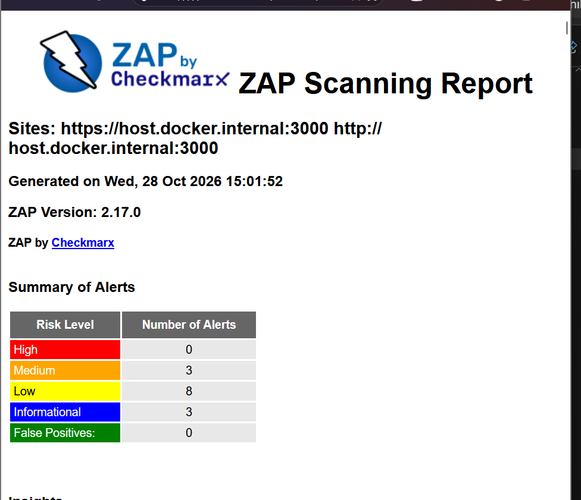
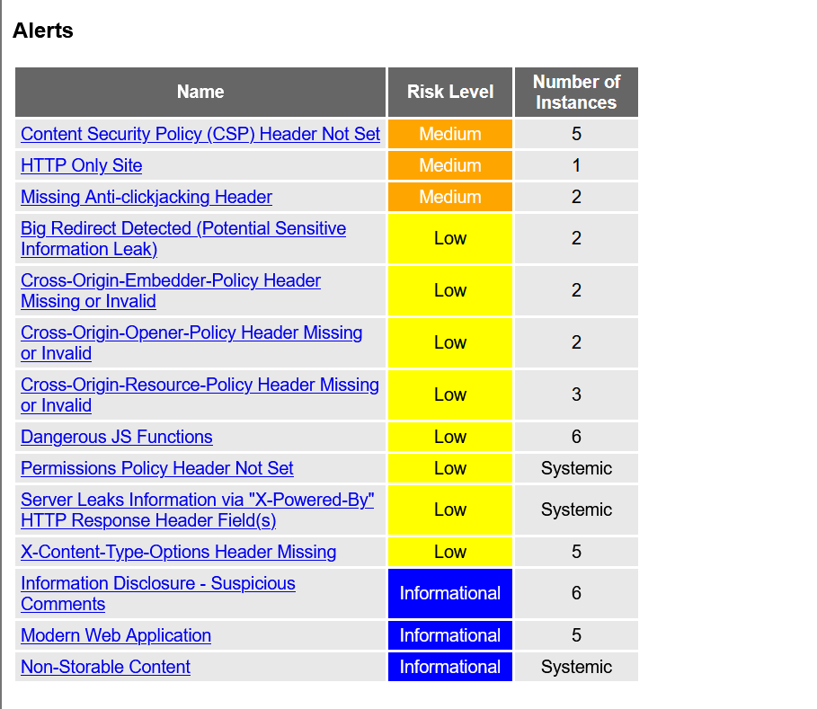
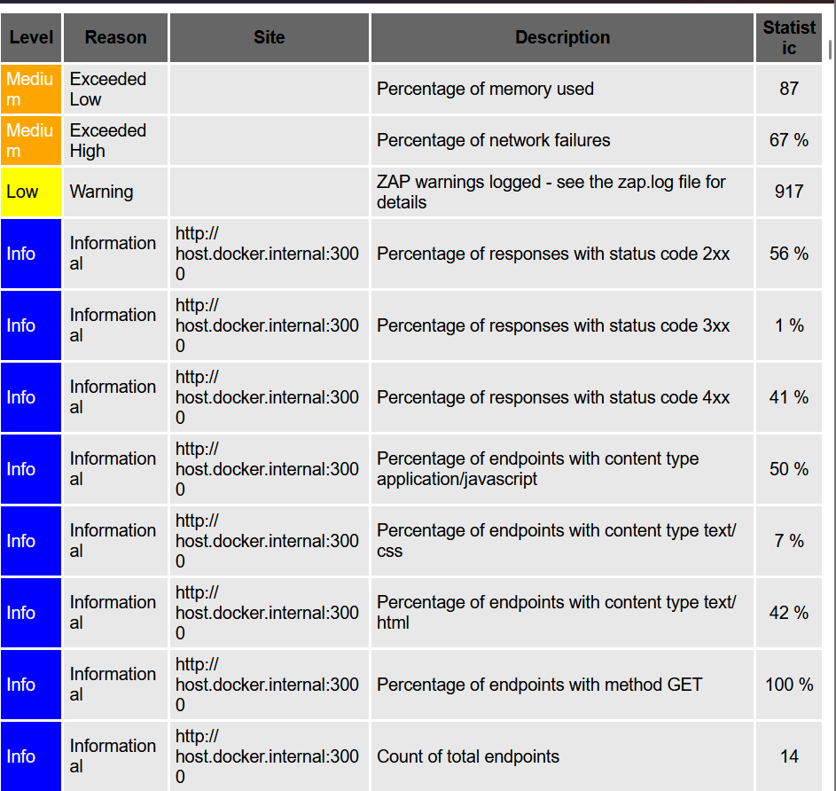


## 5. Analyse et recommandations

-   **CSP absente :** définir une Content Security Policy adaptée aux
    ressources utilisées.
-   **Protection anti-clickjacking absente :** configurer
    `frame-ancestors` dans la CSP et/ou `X-Frame-Options` selon le
    besoin.
-   **`X-Content-Type-Options` absent :** ajouter
    `X-Content-Type-Options: nosniff`.
-   **`X-Powered-By` présent :** désactiver cet en-tête s'il n'est pas
    nécessaire.
-   **Redirection signalée :** vérifier la destination et l'absence
    d'informations sensibles.
-   **Commentaires suspects :** examiner les commentaires trouvés dans
    les fichiers JavaScript et retirer les informations internes si
    nécessaire.

Prioriser les alertes selon leur gravité, leur contexte et leur
exploitabilité. Après correction, relancer ZAP pour vérifier les
résultats.

## 6. Intégration du DAST dans CI/CD

Une pipeline GitHub Actions peut automatiser un Baseline Scan sur une
instance de test :

1.  Construire et démarrer l'application dans l'environnement de test.
2.  Attendre que l'application soit disponible.
3.  Lancer ZAP Baseline Scan sur l'URL de test.
4.  Publier le rapport HTML comme artefact de la pipeline.
5.  Examiner les nouvelles alertes et définir des critères de blocage
    adaptés au projet.

Le Baseline Scan convient à un contrôle passif rapide. Un Active Scan
est plus intrusif et doit être exécuté uniquement sur une instance
autorisée, avec une configuration adaptée. Utiliser des données de test
et ne pas exposer de secrets.


## 7. Conclusion

OWASP ZAP a été utilisé pour réaliser un Baseline Scan et un Active Scan
limité sur UniLink en local. Les rapports ont révélé plusieurs alertes,
principalement liées aux en-têtes HTTP et à la divulgation
d'informations. Ce workshop montre l'intérêt du DAST pour analyser la
sécurité d'une application en exécution et préparer des contrôles
automatisés dans une pipeline CI/CD.
